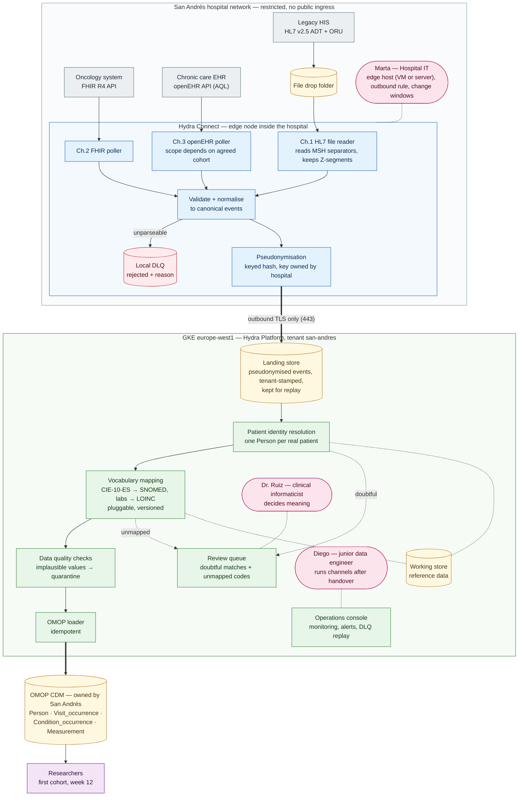

# 1a · Architecture sketch — San Andrés → OMOP CDM

> Rendered image (for viewers without Mermaid support): [`architecture.png`](architecture.png)

## Legend

| Colour | Meaning |
|---|---|
| Grey | Hospital source system |
| Blue | Hydra Connect — runs inside the hospital network |
| Green | Hydra Platform — runs on GKE europe-west1 |
| Yellow (cylinder) | Storage |
| Red (cylinder) | Dead-letter queue |
| Pink (rounded) | Customer team member |
| Purple | Consumer of the result |

## Why each non-obvious box is there

| Box | Why it is there |
|---|---|
| File drop folder | The HIS cannot push over the network; it writes files. Connect must detect half-written and duplicate files. |
| Hydra Connect edge node | No public ingress: something must run inside the hospital to reach the three sources and push data out. |
| One channel per source | Each source speaks differently (files, FHIR REST, openEHR AQL); a channel only handles syntax, never meaning. |
| Ch.3 openEHR | Whether it enters before week 12 depends on the agreed first cohort (e.g. diabetes needs it, oncology does not). |
| Validate + normalise | One shared, documented canonical event format, so Platform does not care where the data came from. Z-segments are kept, not dropped. |
| Local DLQ | Unparseable messages are parked with a reason — never silently lost, never blocking the rest. |
| Pseudonymisation (edge) | Done inside the hospital with a key the hospital owns: no direct identifiers ever reach the cloud. Same patient → same pseudonym, so identity resolution still works. |
| Outbound TLS only (443) | Marta opens one outbound rule; nothing opens inbound. |
| Landing store | Pseudonymised events are kept, so any downstream step can be replayed without asking the hospital again. |
| Patient identity resolution | The same patient can arrive from three systems; Person must have exactly one row. Doubtful matches are never merged automatically. |
| Working store | Platform's own reference data: cross-reference table, vocabulary, quarantine, review items. Researchers never see it. |
| Vocabulary mapping | CIE-10-ES and local lab codes must become OMOP standard concepts; kept separate and versioned so it changes without touching channels. |
| Review queue | Doubtful matches and unmapped codes are decided by a person (Dr. Ruiz), not guessed by the pipeline. |
| Data quality checks | Implausible values (e.g. future dates) are quarantined so they never reach the cohort. |
| OMOP loader (idempotent) | Re-running a load never creates duplicate rows. |
| Operations console | Diego must see what failed and replay it alone after handover — covers Connect channels and Platform steps. |
| OMOP CDM — owned by San Andrés | The research repository belongs to the hospital, outside Hydra Platform. Hosting location is an open question (see pre-kickoff questions). |
